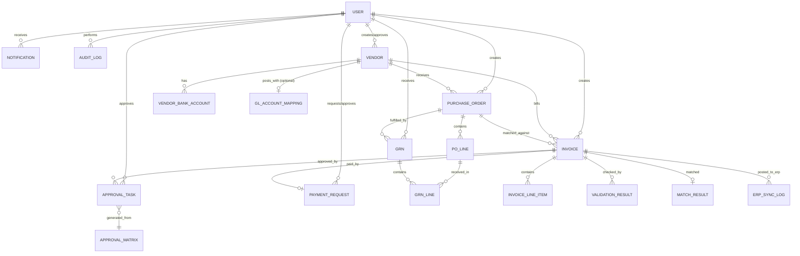

# Database Schema & Relationships

Database: **PostgreSQL** (all DDL also dumped to [`backend/schema.sql`](../backend/schema.sql)).
Django migrations live in each app's `migrations/` folder and are the authoritative
way to create the schema (`python manage.py migrate`).

---

## Entity-Relationship Diagram



---

## Users & Cross-cutting

### accounts_user
| Column | Type | Notes |
| --- | --- | --- |
| id | BIGINT PK | |
| username / email / password | VARCHAR | unique username |
| first_name / last_name | VARCHAR | |
| **role** | VARCHAR(20) | `ADMIN` \| `AP_CLERK` \| `APPROVER` \| `FINANCE` |
| phone | VARCHAR(20) | |
| is_active / is_staff / is_superuser | BOOLEAN | |
| date_joined / last_login | TIMESTAMPTZ | |

### accounts_notification
In-app notifications (approvals, reminders, escalations, payments).
`user_id FK -> accounts_user`, `title`, `message`, `type`
(`INFO|SUCCESS|WARNING|ERROR|APPROVAL|PAYMENT|ESCALATION`), `is_read`, `link`,
`created_at`. Index on (`user_id`,`is_read`).

### core_auditlog
Immutable audit trail written by Django signals for every tracked model.
`user_id FK (nullable)`, `username`, `action`
(`CREATE|UPDATE|DELETE|LOGIN|LOGIN_FAILED|LOGOUT`), `entity`, `entity_id`,
`entity_repr`, `changes JSONB` (field → {old,new}), `ip_address`, `created_at`.

---

## Vendor Management

### vendors_vendor
| Column | Type | Notes |
| --- | --- | --- |
| id | BIGINT PK | |
| code | VARCHAR(20) UNIQUE | e.g. `V-1001` |
| name / legal_name | VARCHAR(200) | |
| **gstin** | VARCHAR(15) | validated: format + PAN embed + **mod-36 check digit** |
| pan | VARCHAR(10) | regex-validated |
| email / phone | VARCHAR | |
| address_line1/2, city, state, **state_code**, pincode | VARCHAR | state code drives CGST/SGST vs IGST |
| **status** | VARCHAR(20) | onboarding: `DRAFT` → `PENDING_APPROVAL` → `APPROVED` / `REJECTED` / `BLOCKED` |
| onboarding_notes | TEXT | |
| created_by / approved_by | FK accounts_user | |
| approved_at | TIMESTAMPTZ | |

### vendors_vendorbankaccount
`vendor_id FK (CASCADE)`, `account_name`, `account_number` (6–20 digits),
`ifsc` (regex `^[A-Z]{4}0[A-Z0-9]{6}$`), `bank_name`, `branch`, `upi_id`,
`is_primary`, `is_verified`.
**Constraint:** `UNIQUE (vendor_id, account_number)`.

---

## Purchase Orders & Goods Receipts

### purchase_orders_purchaseorder
`po_number` UNIQUE, `vendor_id FK (PROTECT)`, `po_date`, `currency`,
`subtotal`, `tax_amount`, `total_amount` (computed from lines server-side),
`status` (`OPEN|CLOSED|CANCELLED`), `notes`, `created_by FK`.

### purchase_orders_poline
`po_id FK (CASCADE)`, `line_number`, `item_code`, `description`, `hsn_code`,
`quantity NUMERIC(12,3)`, `unit`, `unit_price NUMERIC(14,2)`,
`tax_rate NUMERIC(5,2)`, `line_total` (= qty × price, computed on save),
**`received_qty`** (maintained from GRN lines).
`UNIQUE (po_id, line_number)`.

### purchase_orders_grn
`grn_number` UNIQUE, `po_id FK (PROTECT)`, `receipt_date`, `status` (=POSTED),
`remarks`, `received_by FK`.
Goods receipts are immutable once posted (no update/delete endpoints).

### purchase_orders_grnline
`grn_id FK (CASCADE)`, `po_line_id FK (PROTECT)`, `quantity_received NUMERIC(12,3)`.
Posting validates `received_qty + qty ≤ PO quantity` per line and auto-closes
the PO when every line is fully received.

---

## Invoices (core of the system)

### invoices_invoice
| Column | Type | Notes |
| --- | --- | --- |
| id | BIGINT PK | |
| invoice_number | VARCHAR(60) | from OCR or reviewer |
| vendor_id | FK vendors (PROTECT, nullable) | auto-linked via seller GSTIN |
| po_id | FK purchase_orders (PROTECT, nullable) | auto-linked via PO number |
| invoice_date / due_date | DATE | |
| currency | VARCHAR(3) | default INR |
| subtotal / tax_amount / total_amount | NUMERIC(16,2) | |
| **source** | VARCHAR(10) | `UPLOAD` \| `EMAIL` \| `MANUAL` |
| file | FILE → `media/invoices/YYYY/MM/` | |
| file_name / file_type | VARCHAR | PDF/JPG/PNG/TIFF |
| page_count | INT | multi-page support |
| **ocr_status** | VARCHAR(12) | `PENDING` → `PROCESSING` → `COMPLETED`/`FAILED` |
| ocr_confidence | NUMERIC(5,2) | avg confidence from the extraction engine |
| ocr_error / raw_ocr_text | TEXT | diagnostics / full text |
| **extracted_data** | JSONB | identified fields + confidence **+ supplying engine** per field (`fields`, `method`, `extraction_engine`, `ai_assist_used`) |
| **status** | VARCHAR(20) | lifecycle below |
| **erp_status** | VARCHAR(12) | `NOT_SYNCED` \| `SYNCED` \| `FAILED` (ERP/accounting posting) |
| **erp_reference** | VARCHAR(60) | ERP voucher/document reference returned by the connector |
| created_by | FK accounts_user | |
| approved_at / paid_at | TIMESTAMPTZ | for TAT analytics |

**Invoice lifecycle (`status`):**

```
UPLOADED → EXTRACTED → VALIDATED ─┬→ MATCHED ──────┐
                        │         └→ MATCH_EXCEPTION │
                        └→ EXCEPTION (failed rules) │
                                                    ↓
      APPROVED ← PENDING_APPROVAL ←─────────────────┘
         ↓                                   REJECTED / ON_HOLD / CANCELLED
   PAYMENT_REQUESTED → SCHEDULED → PAID
                        ↘ PAYMENT_FAILED ↺ (retry)
```

### invoices_invoicelineitem
`invoice_id FK (CASCADE)`, `line_number`, `description`, `hsn_code`,
`quantity`, `unit`, `unit_price`, `tax_rate`, `line_total`, `ocr_confidence`.
`UNIQUE (invoice_id, line_number)`.

### invoices_validationresult
One row per rule per validation run (previous runs are replaced):
`invoice_id FK`, `check_code`
(`MANDATORY_FIELDS|DUPLICATE_INVOICE|GST_VALIDATION|AMOUNT_VALIDATION|TAX_CALCULATION|VENDOR_MASTER_VALIDATION|ADMIN_OVERRIDE`),
`status` (`PASS|WARN|FAIL`), `message`, `details JSONB`, `created_at`.

### invoices_matchresult
`invoice_id` **OneToOne** (re-running a match replaces the row), `po_id FK`,
`match_type` (`TWO_WAY|THREE_WAY|NOT_APPLICABLE`), `status`
(`MATCHED|MISMATCH|NOT_APPLICABLE`), `total_variance`, `details JSONB`
(header variance, per-line qty/rate/GRN checks, tolerance used), `created_at`.

---

## Workflow & Approvals

### workflow_approvalmatrix (configurable by Admin)
`name`, `level` (1..n), `min_amount`, `max_amount` (NULL = unlimited),
`approver_role`, **`is_parallel`** (all users with the role must approve),
`escalation_hours`, `active`, timestamps.

### workflow_approvaltask
`invoice_id FK (CASCADE)`, `matrix_id FK (SET NULL)`, `level`,
`approver_id FK`, `approver_role`, `status`
(`PENDING|APPROVED|REJECTED|SKIPPED`), `is_active`
(next level activates only after the previous one completes),
`is_parallel`, `escalation_hours`, `due_at`, `escalated`,
`reminder_count`, `comments`, `approved_at`, `created_at`.

Rules enforced by `workflow/services.py`:
- tasks are generated from every active matrix row whose amount band matches;
- a task can only be actioned by an active user with the matching role
  (or the assigned approver / an admin);
- any rejection skips the remaining tasks and rejects the invoice;
- `run_automation` escalates tasks overdue past `escalation_hours` to Admin
  and sends reminders at half the escalation interval.

---

## Payments

### payments_paymentrequest
`payment_number` UNIQUE (`PR-YYYY-#####`), `invoice_id` **OneToOne**,
`amount`, `method` (`NEFT|RTGS|IMPS|CHEQUE|UPI`), `status`
(`PENDING_APPROVAL→APPROVED→SCHEDULED→PROCESSED` / `FAILED` / `CANCELLED`),
`scheduled_date`, `processed_date`, `bank_reference` (UTR), `failure_reason`,
**`is_reconciled`** (True when a bank-statement row matched this payment),
**`reconciled_at`**, `requested_by FK`, `approved_by FK`.
Processing calls the pluggable bank gateway (default: `BANK_GATEWAY=simulated`,
a local simulation with beneficiary IFSC/account validation and UTR generation;
`BANK_GATEWAY=file` instead exports a NEFT/RTGS bulk instruction CSV and the
returned bank statement is uploaded to reconcile payments). The payment advice
PDF is rendered with ReportLab from this row.

---

## Accounting / ERP integration (new in v1.1)

### accounting_glaccountmapping
Ledger configuration used when a purchase voucher is posted to the ERP.
`name` UNIQUE, `vendor_id` **OneToOne NULL** (NULL = the default mapping used
by every vendor without its own row), `expense_account`, `cgst_account`,
`sgst_account`, `igst_account`, `payable_account`, `is_active`, timestamps.

### accounting_erpsynclog
One row per ERP posting attempt. `invoice_id FK (CASCADE)`, `connector`
(SimulatedERPConnector / TallyXMLConnector / a future live adapter), `format`
(`SINGLE_POST|CSV|JSON|TALLY_XML`), `status` (`NOT_SYNCED|SYNCED|FAILED`),
`erp_reference` (voucher number returned by the connector), `error` TEXT,
`payload_preview` JSONB (summary only — no full document), `requested_by FK`,
`created_at` (indexed), `posted_at`.
Business rule enforced in `accounting/services.py`: only `APPROVED` or `PAID`
invoices can be posted; every attempt (success or failure) is logged and
mirrored onto `invoices_invoice.erp_status` / `erp_reference`.

---

## Relationship Summary (FK graph)

```
accounts_user ─┬─ vendors_vendor.created_by / approved_by
               ├─ purchase_orders_purchaseorder.created_by
               ├─ purchase_orders_grn.received_by
               ├─ invoices_invoice.created_by
               ├─ workflow_approvaltask.approver
               ├─ payments_paymentrequest.requested_by / approved_by
               └─ accounts_notification.user

vendors_vendor ─┬─ vendors_vendorbankaccount.vendor
                ├─ purchase_orders_purchaseorder.vendor
                └─ invoices_invoice.vendor

purchase_orders_purchaseorder ─┬─ purchase_orders_poline.po
                               ├─ purchase_orders_grn.po
                               └─ invoices_invoice.po

purchase_orders_poline ─── purchase_orders_grnline.po_line

invoices_invoice ─┬─ invoices_invoicelineitem.invoice
                  ├─ invoices_validationresult.invoice
                  ├─ invoices_matchresult.invoice      (1:1)
                  ├─ workflow_approvaltask.invoice
                  ├─ payments_paymentrequest.invoice   (1:1)
                  └─ accounting_erpsynclog.invoice

vendors_vendor ─── accounting_glaccountmapping.vendor (1:1, optional)
```

## Integrity & Performance

- FKs use `PROTECT` where history must not vanish (vendor/PO/GRN references)
  and `CASCADE` where children are meaningless alone (lines, tasks, results).
- Composite indexes: `invoices(status, created_at)`, `erp_sync_logs(status, created_at)`,
  `notifications(user, is_read)`, `paymentrequest(is_reconciled)`.
- Money columns are `NUMERIC(16,2)`/`NUMERIC(14,2)` — never floats.
- All timestamps are timezone-aware (`Asia/Kolkata`).
- Duplicate protection: validation engine detects same vendor + invoice number
  (`iexact`) *before* it becomes a hard DB error, and the reviewer serializer
  enforces the same rule.
